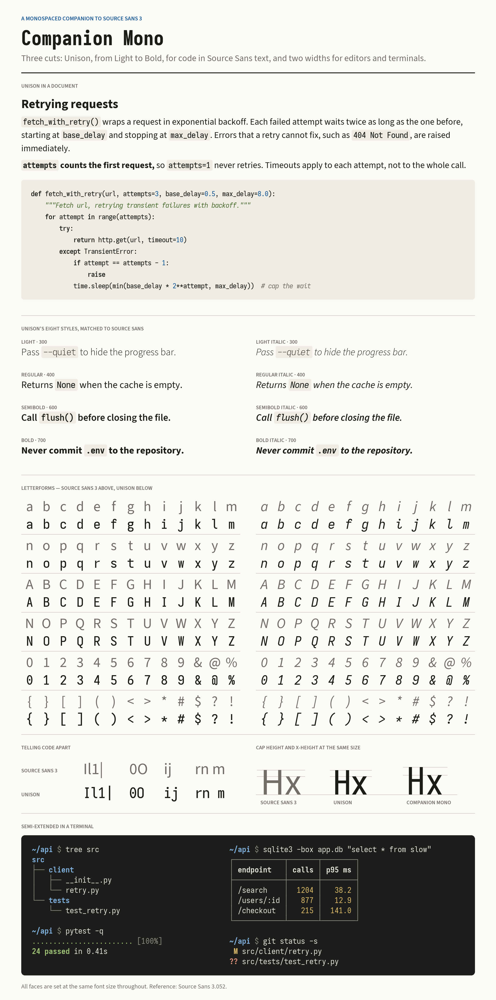
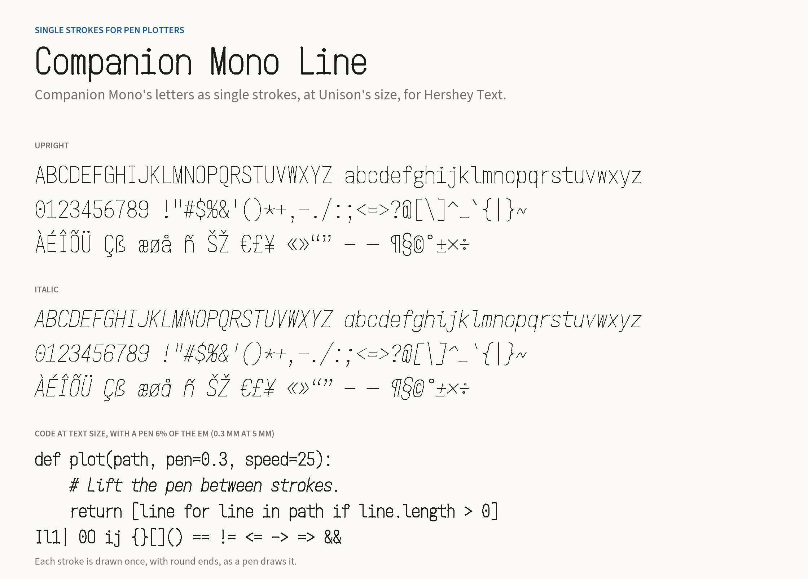

# Companion Mono

A custom Iosevka family designed to sit beside **Source Sans 3**, in three cuts of six static styles each (Regular, Italic, Semibold, Semibold Italic, Bold, Bold Italic), and Light and Light Italic in Unison:

- **Companion Mono Unison** matches Source Sans's x-height and weights, from Light to Bold, for code set in Source Sans text, such as documentation and web pages.
- **Companion Mono** keeps Iosevka's own, taller proportions, for code on its own in editors.
- **Companion Mono Semi-Extended** has a roomier cell for terminals and editors.

For pen plotters, **Companion Mono Line** draws the same letters as single strokes; see [Pen plotters](#pen-plotters).



## Install

Open the files in `fonts/ttf/` and install them with your operating system's font manager. The TTFs are build outputs and are not tracked in git: download them from the [latest release](../../releases/latest), one by one or in the zip's `fonts/ttf/`, or build them (see below). Select **Companion Mono**, or **Companion Mono Unison** beside Source Sans, in your editor or application. Restart an application if the family does not appear immediately.

- macOS: select the TTF files and open them in Font Book, then install.
- Windows: select the TTF files, right-click, and choose Install.
- Linux: copy the TTF files into `~/.local/share/fonts/CompanionMono/`, then run `fc-cache -f`.

Both widths are in the **Companion Mono** family, and Unison is a family of its own, **Companion Mono Unison**. Semi-Extended styles are named "Semi-Extended", "Bold Semi-Extended Italic", and so on. In Ghostty, select them by style:

```
font-family = "Companion Mono"
font-style = "Semi-Extended"
font-style-bold = "Bold Semi-Extended"
font-style-italic = "Semi-Extended Italic"
font-style-bold-italic = "Bold Semi-Extended Italic"
```

The terminal spacing mode permits a few Unicode glyphs to occupy two cells; Fontconfig therefore reports dual-width spacing (90). All printable ASCII uses one cell, 500 units wide (547 in Semi-Extended, 467 in Unison). If an application requires strictly single-width fonts, set `spacing = "fontconfig-mono"` in the build plan and rebuild; some wide Unicode arrows are then omitted.

## Design choices

- **Proportions:** Companion Mono keeps Iosevka's own: cap height and ascenders 735, x-height 520 at 1000 units per em. Source Sans 3's are 656, 712, and 486, so at the same font size Companion Mono's lowercase is about 7% taller and its capitals about 12% taller. Unison is the standard width scaled to 93.4% after the build, so its x-height is Source Sans's 486. Scaling the finished outlines keeps Iosevka's geometry intact, which overriding the x-height in the build plan would not. Unison's capitals and figures are built lower, so after scaling they stand at Source Sans's cap height, 656, below ascenders of 686, as Source Sans's capitals stand below its ascenders; the ascenders are 4% shorter than Source Sans's.
- **Width:** a 500-unit cell, Iosevka's standard. Source Sans averages 464 units per lowercase letter in English text, so a line of code runs about 8% wider than the same line of prose. Unison's cell scales to 467 units, so its code runs about as wide as prose. Semi-Extended uses Iosevka's 547-unit cell. Iosevka's letters are narrow for their height, so Unison's side spacing is 20% tighter than Iosevka's and its letters fill more of the cell: for their height, Regular's `n` is 96% as wide as Source Sans's and its `H` 79%, and Bold's 87% and 73%, since Source Sans widens as it gets bolder. Capitals cannot come closer in a monospaced cell, where they are as wide as the lowercase; Source Sans's are about 20% wider than its lowercase.
- **Weight:** Regular stems match Source Sans 3's (82 units upright, 76 italic). Source Sans's letters widen as they get bolder, but a monospaced cell cannot, so matching Source Sans Bold's 147-unit stems would leave bold text cramped and its counters filled in at small sizes. Bold instead matches Source Sans Bold's density in Unison and the standard width: the stems of `n` fill about 51% of the cell (120-unit stems in Unison's 467-unit cell, 128 in the standard width's 500), as Source Sans Bold's fill its wider letter, so bold code is as dark as bold prose. Unison is built heavier than the standard width, so its stems meet these targets after scaling. Semi-Extended, for terminal text that is small and often light on dark, follows monospaced fonts tuned for small sizes: the stems of `n` fill 44% of its cell, like SF Mono (120-unit stems). Semibold sits at the geometric mean of Regular and Bold, so the steps look even. Unison also has Light, with Source Sans 3 Light's stems (44 units upright, 41 italic), for code in Light text; the other cuts are for editors and terminals, where so light a weight is too faint at small sizes. As in Source Sans, the italics are lighter than the uprights. Menu and CSS weights are 300 (Unison's Light), 400, 600, and 700. Iosevka's stroke contrast is lower than Source Sans's, so curves look slightly more even.
- **Letterforms:** the family follows Source Sans where a monospace allows it: double-storey upright a and g, a 1 with a flag and base, a 6 that sweeps into its bowl, a 9 whose stem drops straight before it curves, flat-bottomed M, a crossbar on f at the x-height, straight braces, and a percent sign with a continuous slash. The at sign is Iosevka's compact form, within the cap height, and the punctuation dots are 15% smaller than Iosevka's, closer to Source Sans's. Italics use Source Sans's cursive forms, including single-storey a and g and cursive Cyrillic а, в, ь, ъ, ы and Greek φ.
- **Code distinctions:** a short-serifed capital I, serifed i and j, an l with a top serif and Source Sans's small tail, and a dotted zero. These depart from Source Sans so `Il1|`, `0O`, and `ij` stay distinct in a fixed-width cell. The asterisk sits on the operator axis rather than raised as in Source Sans.
- **Code details:** terminal-oriented symbol widths, and programming ligatures through discretionary ligatures (`dlig`), off by default. Letterforms are fixed by the build plan; the fonts have no character-variant or stylistic-set features.
- **Line spacing:** in every cut, the line metrics are Source Sans 3's exactly (ascender 1000, descender −326, no line gap), so inline code shares the baseline and line box of surrounding Source Sans text and does not stretch the line. Box drawing, block elements, and Powerline glyphs span the same line box, also in Unison, where they keep their height when scaled, so they join from line to line in terminals and editors that draw them from the font. Separate Windows clipping bounds cover every glyph, including tall stacked accents.

This is a companion, not an outline clone or a metrics-compatible replacement for Source Sans 3. Iosevka's curve construction and monospaced rhythm remain visible. The customization uses the public build-plan interface; upstream source code is unchanged.

## Web use

Copy `fonts/woff2/` and `companion-mono.css` together, retaining their relative paths, and load the stylesheet:

```html
<link rel="stylesheet" href="companion-mono.css">
```

```css
body {
  font-family: "Source Sans 3", sans-serif;
  font-size: 16px;
  line-height: 1.5;
}
code, pre, kbd, samp {
  font-family: "Companion Mono Unison", monospace;
  font-size: 1em;
  line-height: inherit;
  font-synthesis: none;
  font-variant-ligatures: none;
}
```

If you want programming ligatures, replace `font-variant-ligatures: none` with `font-feature-settings: "dlig" 1` on the code elements. The web fonts are Companion Mono Unison, subset to Latin (including Vietnamese), Greek, Cyrillic, punctuation, currency, arrows, mathematical and technical symbols, and box drawing, 140–160 KB per style (hinted); `companion-mono.css` declares that coverage with `unicode-range`. Unison's x-height matches Source Sans's, so code needs no size correction at `font-size: 1em`.

## Pen plotters

**Companion Mono Line** draws each of Companion Mono's letters as a single stroke, for pen plotters such as the AxiDraw. Its two SVG fonts in `fonts/svg/`, upright and italic, are for Inkscape's Hershey Text extension. They are set at Unison's size, so they pair with EMS Readability, the single-stroke Source Sans Light that comes with Hershey Text: their x-heights match, and the letterforms follow Source Sans where a monospace allows, as in the other cuts.

In Inkscape, open Extensions › Text › Hershey Text, set the font face to "Other (given below)", and enter the full path of `fonts/svg/CompanionMonoLine.svg` or `fonts/svg/CompanionMonoLineItalic.svg`. Each font has 228 characters: printable ASCII, Latin-1, and the other accented letters and punctuation that EMS Readability has. The plotter's pen sets the line width.



## Rebuild or change the design

The complete source recipe is `build/private-build-plans.toml`. The build is pinned to **Iosevka v34.9.0**, commit `2487637bb71f41b2a66134afd9faa6c316e5a438`; the reference is **Adobe Source Sans 3.052** (`3.052R`).

Install Git, Node.js 24, npm, and [uv](https://docs.astral.sh/uv/). uv supplies ttfautohint (the `ttfautohint-py` wheel) and the Python checking tools, so nothing else needs a system install. Then run:

```bash
bash build/build.sh              # all styles of every cut into fonts/, then finalize and check
bash build/build.sh draft        # unhinted TTFs only, for design iteration (about half the time)
uv run build/render-preview.py   # preview against Source Sans 3 -> preview.png
bash build/build.sh line         # Companion Mono Line's SVG fonts -> fonts/svg/
uv run build/line/render.py      # Companion Mono Line preview -> preview-line.png
```

The first run clones the pinned Iosevka source into `.cache/iosevka` and installs its locked dependencies; later runs reuse that checkout and Iosevka's build cache, which keeps the geometry of each shape weight, width, and slope. Draft fonts land in `.cache/draft/`; preview them with `uv run build/render-preview.py .cache/draft .cache/draft.png`. Both modes end with `build/check-weights.py`, which prints the stem table in `VALIDATION.md` and fails if any weight is more than 2 units off its target. Iosevka builds and hints Companion Mono; it builds Unison unhinted, `build/scale-unison.py` scales it, and `build.sh` then hints it with ttfautohint as Iosevka hints the others. `build/finalize.py` then sets the line metrics and writes the subset WOFF2 files and `companion-mono.css`. The build defaults to two concurrent jobs; each can require more than 1 GB of memory. Use `JOBS=1` on a smaller machine. Fonts are stamped with the last commit's time rather than the build time, so builds of the same commit with the same toolchain are byte-identical; other toolchain versions can change binary hashes.

`line` mode takes Companion Mono Line from the same build plans in about half a minute. `build/line/extract.mjs` runs the pinned Iosevka as a library and traces the centerline of each stroke in a glyph's construction, at a hairline weight. `build/line/write_svg.py` merges those centerlines, reduces filled shapes that stand for strokes to their middle lines, joins strokes that meet, and writes the SVG fonts at Unison's size. Dots and other small filled shapes stay as outlines. A letterform change in the build plans reaches Companion Mono Line on the next `line` build.

The recipe has six build plans: `CompanionMono` and `CompanionMonoItalic` for the standard width, `CompanionMonoSemiExtended` and `CompanionMonoSemiExtendedItalic`, and `CompanionMonoUnison` and `CompanionMonoUnisonItalic`. The other plans inherit the letterforms from `CompanionMono`, so letterform changes go there only, under `design` for both slopes or `upright`/`italic` for one. Weights, ligations, and naming are set in each plan. Some useful edits:

- For a plain zero like Source Sans's, set `zero = "oval-unslashed"` under `variants.design`.
- To change a cell width, edit its `widths` `shape` (Semi-Extended's is 547), then recalibrate that width's weights until `build/check-weights.py` passes: Iosevka's strokes thicken as the cell widens.
- To change Unison's size, change `NEW_UPEM` in `build/scale-unison.py` (934 scales to 93.4%), set Unison's `cap` in the build plans to 656 × 1000 / `NEW_UPEM` so its capitals still scale to Source Sans's cap height, then recalibrate Unison's weights the same way.
- Use `menu` and `css` for exposed weight names; `shape` changes the drawn weight.

After changes, inspect accents, punctuation, mathematical symbols, and all weights as well as ordinary text.

To publish a release, set the same `version` in every build plan, commit, and push a matching tag, such as `git tag v1.3.0 && git push origin v1.3.0`. `.github/workflows/release.yml` then builds every cut and Companion Mono Line from that commit on GitHub and publishes a new release with each TTF, WOFF2, and SVG font file and `CompanionMono-1.3.0.zip`, which holds them all with `companion-mono.css` and `OFL.md`. It stops before building if the tag and the build plans' version differ.

## Provenance and licenses

Companion Mono: Peter Baumgartner. Original Iosevka design: Renzhi Li (Belleve Invis). Source Sans 3 design: Paul D. Hunt / Adobe. Companion Mono is an independent custom build and is not an official release or endorsement by either project. No Source Sans outlines were incorporated into Companion Mono.

The fonts, including Companion Mono Line, and their build plan remain under the SIL Open Font License 1.1 ([`OFL.md`](OFL.md)). The build scripts are under the MIT License ([`build/LICENSE`](build/LICENSE)). The included, unmodified Source Sans reference fonts have their own OFL notice ([`licenses/OFL-Source-Sans-3.md`](licenses/OFL-Source-Sans-3.md)).

- [Iosevka build documentation](https://github.com/be5invis/Iosevka/blob/v34.9.0/doc/custom-build.md)
- [Iosevka source at the pinned commit](https://github.com/be5invis/Iosevka/tree/2487637bb71f41b2a66134afd9faa6c316e5a438)
- [Source Sans 3.052 reference release](https://github.com/adobe-fonts/source-sans/releases/tag/3.052R)

Validation results are recorded in `VALIDATION.md`.
